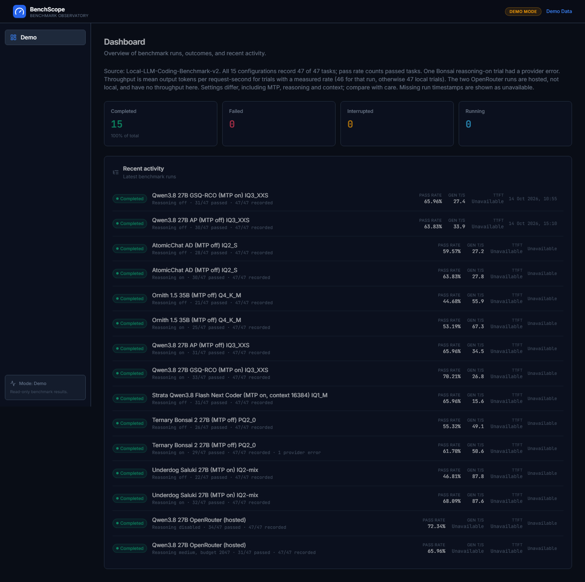

# BenchScope

BenchScope is a local-first observatory for importing, comparing, and understanding local LLM coding-benchmark results. It turns isolated benchmark runs into a durable, inspectable history while keeping the proprietary benchmark itself out of this repository.

**Live demo:** https://shanegore.github.io/BenchScope/
**API readiness:** https://benchscope-staging-api.onrender.com/ready

## Key features

- Validated benchmark result import for v1 and v2 contracts.
- Persistent run history, detail views, and compatible-run comparison.
- Model profiles with version, quantisation, endpoint, and hardware notes.
- Synthetic read-only public demo for unauthenticated visitors.
- Clerk authentication with backend-enforced owner isolation.
- Docker Compose full-stack local setup with PostgreSQL and observability.
- Five-job CI on Linux and Windows, including process-tree safety tests.
- Automatic staging deployment and documented rollback.
- OpenTelemetry metrics, traces, and structured logs.
- Alerting and supervised AI-assisted incident recovery.
- Local Windows subprocess safety foundation for future benchmark execution.

## Honest limitation

Real benchmark launch and cancellation are not yet connected to the private runner. Issue #25 remains open. The local subprocess adapter is implemented and tested with synthetic runners only; no full private benchmark has been executed by BenchScope.

## Architecture

- Frontend: React, Vite, TypeScript
- Backend: Python 3.12, FastAPI, SQLAlchemy, Alembic
- Database: PostgreSQL
- Authentication: Clerk
- Observability: OpenTelemetry, Prometheus, Grafana, Loki, Tempo
- Deployment: GitHub Pages, Render Free, Neon Free

See _docs/architecture/README.md for details.

## Local quick start

### Backend

`powershell
cd backend
uv sync
uv run alembic upgrade head
uv run uvicorn app.main:app --reload
`

### Frontend

`powershell
cd frontend
corepack enable
corepack pnpm install
corepack pnpm dev
`

### Docker Compose

`powershell
docker compose up
`

## Testing

`powershell
cd backend
uv run ruff format --check .
uv run ruff check .
uv run pytest
`

`powershell
cd frontend
corepack pnpm test
corepack pnpm build
`

## Documentation

- Setup and architecture: _docs/
- Agent workflow: AGENTS.md
- Submission pack: _docs/submission/
- Incident runbooks: _docs/incidents/
- Known limitations: _docs/submission/known-limitations.md

## Licence

This repository's first-party BenchScope code is licensed under the MIT Licence. See [LICENSE](./LICENSE).

Third-party code, dependencies, and private benchmark materials remain subject to their own licences and are not covered by this licence.

- Issue #21: closed (hosted deployment and rollback evidence)
- Issue #25: open (real runner contract and integration)
- CI/CD: five required checks protect main
- Cost model: $0 recurring cost using free tiers

## Import contracts

BenchScope supports two result contracts.

### v1

- Legacy benchmark result import.
- Validates required fields and normalises metrics.
- Preserves missing metrics as `null` rather than converting them to zero.
- Detects duplicates using a stable ID or fingerprint where available.

### v2

- Adds benchmark identity, release, canonical manifest SHA-256, and expected task IDs.
- Records per-task pass/fail outcomes.
- Distinguishes missing tasks from failed tasks.
- Keeps `pass_rate` null unless task coverage is complete.
- Keeps `quality_score` null until an authoritative scoring definition exists.
- Enforces strict comparison compatibility by benchmark release and manifest.

## Operating modes

### Local mode

- Imports and persists results locally.
- Binds to loopback by default.
- Does not launch or cancel the private benchmark.
- Never exposes local model endpoints or private benchmark paths.

### Hosted multi-user mode

- Users sign in with Clerk.
- Profiles and run history are owner-scoped.
- Unauthenticated visitors can use a read-only synthetic demo.
- Hosted mode imports independently produced result files.
- Hosted import processing stores only allowlisted non-confidential metrics and metadata and discards the uploaded raw payload.

### Anonymous demo mode

- Read-only synthetic data.
- No import, profile editing, deletion, or personal record access.
- Used for public demonstrations without exposing private data.

## Expected behaviour

- The application starts using documented commands.
- Valid result files can be imported.
- Invalid imports are rejected without corrupting persisted data.
- Missing metrics remain null.
- Incomplete task coverage does not become a misleading score.
- Comparisons are restricted to compatible benchmark manifests and releases.
- Personal records are isolated by authenticated owner identity.

## Privacy and safety

- Private prompts, reference answers, hidden tests, generated code, raw model responses, and confidential benchmark paths are never committed or publicly served.
- Hosted import processing stores only allowlisted non-confidential metrics and metadata.
- Benchmark integration must not accept arbitrary commands from browser requests.
- The private benchmark is not executed in hosted mode.

## Known limitations

- Issue #25 remains open.
- Real benchmark launch and cancellation are not implemented.
- The local subprocess adapter is implemented and tested with synthetic runners only.
- `quality_score` remains null until an authoritative definition exists.
- Observability dashboards and alerts are verified in local Docker Compose.
