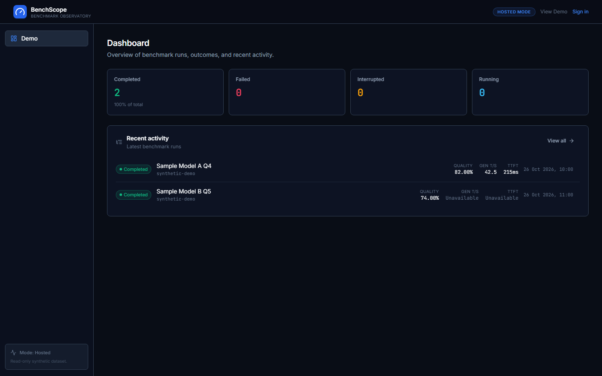

# BenchScope

BenchScope is a local-first observatory for importing, comparing, and understanding local LLM coding-benchmark results. It turns isolated benchmark runs into a durable, inspectable history while keeping the proprietary benchmark itself out of this repository.

**Live demo:** https://shanegore.github.io/BenchScope/
**API readiness:** https://benchscope-staging-api.onrender.com/ready

## Key features

- Validated benchmark result import for v1 and v2 contracts.
- Persistent run history, detail views, and compatible-run comparison.
- Model profiles with version, quantisation, endpoint, and hardware notes.
- Synthetic read-only public demo for unauthenticated visitors.
- Clerk authentication with backend-enforced owner isolation.
- Docker Compose full-stack local setup with PostgreSQL and observability.
- Five-job CI on Linux and Windows, including process-tree safety tests.
- Automatic staging deployment and documented rollback.
- OpenTelemetry metrics, traces, and structured logs.
- Alerting and supervised AI-assisted incident recovery.
- Local Windows subprocess safety foundation for future benchmark execution.

## Honest limitation

Real benchmark launch and cancellation are not yet connected to the private runner. Issue #25 remains open. The local subprocess adapter is implemented and tested with synthetic runners only; no full private benchmark has been executed by BenchScope.

## Architecture

- Frontend: React, Vite, TypeScript
- Backend: Python 3.12, FastAPI, SQLAlchemy, Alembic
- Database: PostgreSQL
- Authentication: Clerk
- Observability: OpenTelemetry, Prometheus, Grafana, Loki, Tempo
- Deployment: GitHub Pages, Render Free, Neon Free

See _docs/architecture/README.md for details.

## Local quick start

### Backend

`powershell
cd backend
uv sync
uv run alembic upgrade head
uv run uvicorn app.main:app --reload
`

### Frontend

`powershell
cd frontend
corepack enable
corepack pnpm install
corepack pnpm dev
`

### Docker Compose

`powershell
docker compose up
`

## Testing

`powershell
cd backend
uv run ruff format --check .
uv run ruff check .
uv run pytest
`

`powershell
cd frontend
corepack pnpm test
corepack pnpm build
`

## Documentation

- Setup and architecture: _docs/
- Agent workflow: AGENTS.md
- Submission pack: _docs/submission/
- Incident runbooks: _docs/incidents/
- Known limitations: _docs/submission/known-limitations.md

## Project status

- Issue #21: closed (hosted deployment and rollback evidence)
- Issue #25: open (real runner contract and integration)
- CI/CD: five required checks protect main
- Cost model:  recurring cost using free tiers
