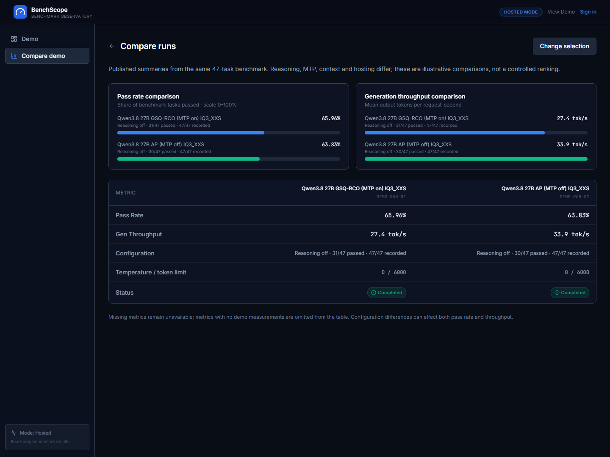

# BenchScope

A local-first observatory for coding-benchmark results. Import a result once, keep an inspectable history, and compare coding accuracy, generation speed, and configuration choices across local language models.

[](https://github.com/ShaneGore/BenchScope/actions/workflows/ci.yml)

[Explore the live demo](https://shanegore.github.io/BenchScope/) · [API readiness](https://benchscope-staging-api.onrender.com/ready) · [Public task tracker](https://github.com/ShaneGore/BenchScope/issues)

The demo is read-only and needs no account. Select **Compare configurations**, choose two or more results, and inspect their pass rate, throughput, and settings. The free-tier API can take about a minute to wake after inactivity; Retry is available if loading fails.



## Why it exists

Local LLM evaluations often end up as disconnected JSON files or spreadsheet rows. Model versions, quantisation, reasoning settings and incomplete measurements make those results difficult to interpret. BenchScope turns supported result files into validated, persistent records with explicit configuration snapshots and missing-data semantics.

- **Import and persist:** v1/v2 JSON contracts, validation, duplicate detection, PostgreSQL and Alembic migrations.
- **Inspect and compare:** run history, filters, task outcomes, side-by-side metrics and pass-rate/throughput charts. Personal v2 comparisons enforce benchmark release and manifest compatibility.
- **Keep workspaces private:** Clerk sign-in and backend-enforced owner scoping; anonymous visitors see only the published demo catalogue.
- **Operate and verify:** containerised local stack, Linux/Windows CI, browser journeys, automatic staging deployment, local correlated telemetry and supervised incident-response components.

## Run locally

Install [uv](https://docs.astral.sh/uv/) and Docker Desktop (or a local Docker Engine with Compose v2). Start Docker, then run from the repository root:

```powershell
uv run --no-project python scripts/start.py
```

Open **http://127.0.0.1:5173**. The command creates a missing ignored `.env` with a random PostgreSQL password and explicit local-development authentication, then builds and starts the frontend, API and database. Existing `.env` files are preserved; configuration errors explain what needs updating. Default ports are 5173, 8000 and 5432; set `FRONTEND_PORT`, `API_PORT` and `POSTGRES_PORT` in `.env` if they are occupied. Data survives container restarts. Stop the core stack with `uv run --no-project python scripts/start.py --stop`; its PostgreSQL volume is retained.

For local Grafana, Prometheus, Loki, Tempo, OpenTelemetry collection and alert intake:

```powershell
uv run --no-project python scripts/start.py --observability
```

Stop the optional stack with `uv run --no-project python scripts/start.py --stop --observability`. This optional stack provisions a missing local receiver secret without replacing existing configuration. See the [incident documentation](_docs/incidents/) for controlled exercises.

The experimental repair worker is **operator-controlled**, not started by default. To run it in the foreground alongside observability, use `uv run --no-project python scripts/start.py --observability --repair-worker`; Ctrl+C stops the worker and leaves the stack running. Set `BENCHSCOPE_COPILOT_CLI` to a compatible local Copilot CLI if the default lacks the required flags. The checkout must be clean and match the remote PR base exactly; `BENCHSCOPE_REPAIR_BASE_BRANCH` selects a controlled demonstration base instead of `main`. Application edits are restricted to the metrics enable condition and literal health response. The worker uses local Copilot and GitHub CLI authentication, and its GitHub credentials are not least-privilege isolated. It must not be left unattended on a primary account; its host process is not an OS sandbox. Draft PRs require human review. See [known limitations](_docs/submission/known-limitations.md) before use.

Try importing the [synthetic example](frontend/public/examples/synthetic-run.json), also downloadable from the Import page. Its values are invented for onboarding and testing; they are not benchmark measurements. Re-importing it demonstrates duplicate detection.

## Verify the project

With Docker running, install Node.js 22 with Corepack, then run from the repository root:

```powershell
uv run --no-project python scripts/verify.py
```

The command provisions a disposable PostgreSQL database, installs locked dependencies, runs backend lint/unit/integration tests, frontend tests and production build, API-contract checks, and browser journeys. It selects isolated local ports and removes its own test resources afterward. Failed checks produce a nonzero exit code. Unit tests use explicit API/mode settings so a developer's local configuration cannot change their expectations.

For individual suites, run `uv run pytest` from `backend/` or `corepack pnpm test` from `frontend/`. PostgreSQL integration tests require a disposable `TEST_DATABASE_URL`; the root verifier provides one.

## Engineering decisions

- **Missing does not mean zero.** Unmeasured metrics remain `null`; incomplete v2 task coverage cannot become a misleading pass rate.
- **Compare like with like.** Personal v2 run comparisons use benchmark identity, release, manifest digest and task set. Public summary charts disclose differing inference settings instead of implying a controlled ranking.
- **Separate public data from private work.** Demo comparison reads the immutable public catalogue using GET requests. Import payloads are allowlisted, owners come from verified identity, and the private benchmark stays outside hosted execution.
- **Make failures inspectable.** Failed and interrupted attempts stay in history. Local request logs, spans and metric exemplars support correlation without recording prompts or credentials.

[Architecture and tradeoffs](_docs/showcase/engineering-decisions.md) · [OpenAPI contract](openapi.yaml) · [Deployment guide](_docs/architecture/deployment.md)

## Demo methodology

The catalogue contains 15 configurations from the owner's Local-LLM-Coding-Benchmark-v2 results: 13 local configurations and two hosted OpenRouter configurations, each recording 47 tasks. Passing requires import plus public and hidden checks. One Bonsai reasoning-on trial had a provider error.

Local throughput is mean output tokens per request-second over measured trials, not aggregate run throughput: 46 measurements for that Bonsai run, otherwise 47. Hosted throughput is unavailable. Reasoning, MTP and context settings differ. Only two runs have verified driver-log boundaries. Raw trials and evaluation material remain private; published summaries expose aggregate metrics and configuration labels.

## Development process and evidence

PM, engineering and QA roles work against checkable acceptance criteria, with QA failures returned for correction. [AGENTS.md](AGENTS.md) links the modular instructions and [process](_docs/process.md).

The public tracker records [frontend/API integration and review](https://github.com/ShaneGore/BenchScope/issues/13), [metric-to-trace verification](https://github.com/ShaneGore/BenchScope/issues/35), and the [showcase improvement plan](https://github.com/ShaneGore/BenchScope/issues/56). These records describe the checks performed and their limits; current workflow results are available in [GitHub Actions](https://github.com/ShaneGore/BenchScope/actions).

## Scope

BenchScope imports and compares results produced independently. Direct private benchmark execution remains tracked in [#25](https://github.com/ShaneGore/BenchScope/issues/25). Detailed implementation and operational evidence, including the incomplete autonomous on-call chain, is recorded in the [submission checklist](_docs/submission/submission-checklist.md) and [known limitations](_docs/submission/known-limitations.md).

## Stack and licence

React / Vite / TypeScript · FastAPI / SQLAlchemy / Alembic · PostgreSQL · Clerk · OpenTelemetry / Prometheus / Grafana / Loki / Tempo. Hosted frontend: GitHub Pages; staging API: Render; hosted database: Neon.

First-party code uses the [MIT Licence](LICENSE). Private benchmark materials and third-party dependencies retain their own licences.
